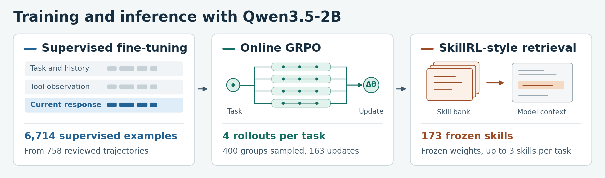
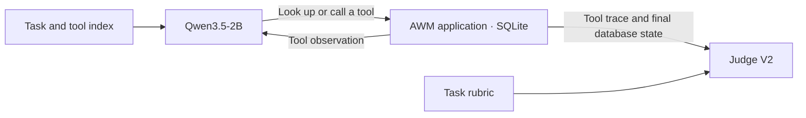
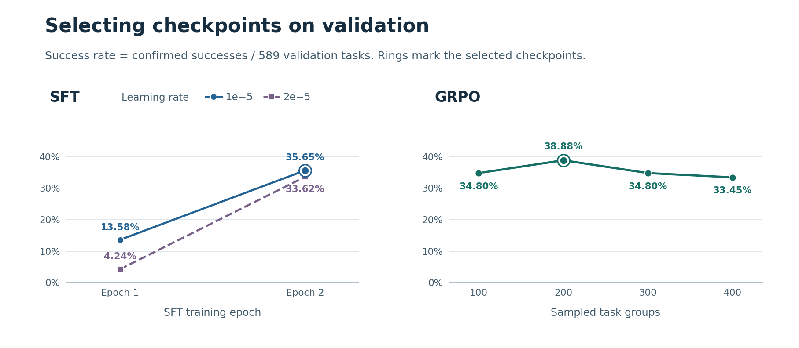

# App Agent

<div align="center">

[简体中文](README.md) · **English**

Training Qwen3.5-2B to discover tools and complete multi-step tasks in simulated applications with their own databases.

[Results](#results) · [Quick start](#quick-start) · [Code and documentation](#code-and-documentation)

</div>



## The AWM environment

Each task starts a separate Agent World Model (AWM) application with its own SQLite database. The model sees a task and a tool index, looks up tool arguments as needed, and submits one JSON action per turn. Each tool observation informs the next action. After the model calls `finish`, Judge V2 checks the tool trace and final database state against the task rubric. [Upstream AWM](https://github.com/Snowflake-Labs/agent-world-model) · [Interaction protocol](harness_awm/protocol_v2.py)

For example, a membership-management calibration task asks the agent to update the current account’s phone number, add the `corporate` tag and preserve the existing tags. Changing the phone number completes only part of the task. The judge can inspect the final record for the tags and the trace for the actions taken. [Calibration tasks](configs/training/grpo-calibration-controls.json)



## Training and evaluation

| Stage | Experiment | Code |
|---|---|---|
| Base-model evaluation | Run a split in BF16 with greedy decoding and record each task outcome. | [Evaluation entry point](harness_awm/training/evaluate.py) |
| Supervised fine-tuning (SFT) | Train on reviewed trajectories. Earlier messages supply context and only the current assistant response contributes to the loss. | [SFT trainer](harness_awm/training/sft.py) |
| Online GRPO | Sample four trajectories for the same task. Use within-group reward differences to update the policy and compare checkpoints on validation. | [veRL training entry point](harness_awm/training/verl/__main__.py) |
| SkillRL-style retrieval | Extract workflows and failure reminders from training trajectories. Retrieve them by task at inference time with the model weights frozen. | [Skill extraction](harness_awm/skillbank_build.py) · [Paired evaluation](harness_awm/training/skill_eval.py) |

The GRPO training reward is `R = C × [1 − 0.05 × (1 − S) − 0.15 × (1 − T)]`. Completion `C` is 1 when all hard requirements pass, 0 when any fails, and 0.3 when review leaves a hard requirement unresolved with no confirmed failure. The soft-requirement score `S` and trajectory-quality score `T` determine the reward discount. [Judge V2 scoring rules (Chinese)](docs/judge_v2_zh.md)

## Results

| Model and configuration | Validation (589 tasks) | Held-out test (588 tasks) |
|---|---:|---:|
| Initial SFT, `checkpoint-210` | **210/589 (35.65%)** | 214/588 (36.39%) |
| GRPO after 200 sampled groups | **229/589 (38.88%)** | 197/588 (33.50%) |
| GRPO-200 with SkillRL-style retrieval | **275/589 (46.69%)** | Unevaluated |

GRPO-200 completed **197/588 held-out test tasks (33.50%)**. The **275/589 (46.69%)** reported for GRPO-200 with SkillRL-style retrieval comes from the validation set. Compared with initial SFT, GRPO completed 19 more validation tasks (**+3.23 percentage points**) and 17 fewer held-out test tasks.

Success rate is the number of confirmed successes divided by the total number of tasks in the split, expressed as a percentage rounded to two decimal places. With 588 held-out test tasks, no whole number of successes yields 39.50% or 47.27% under this rule. [Checkpoint results, scoring coverage and source hashes](docs/qwen35-2b-results.json)

Tasks with provisional or missing judgments still count in the denominator. The three validation runs obtained 585, 581 and 537 valid judgments, and the two held-out test runs obtained 573 and 567. SFT used an OpenAI judge. GRPO used DeepSeek with OpenAI fallback.

The skill run held GRPO-200 weights fixed and used a separate `deepseek-flash` scoring pass. Of 589 tasks, 275 were confirmed successes, 262 were confirmed failures, 47 had indeterminate judgments and 5 had incomplete inference. The batch lacked a matched run with skills disabled, so the effect attributable to skills remains unmeasured.



Among four SFT candidates, epoch 2 at `1e-5` reached 210 confirmed successes. GRPO peaked at 229 after 200 sampled groups and 86 optimizer updates, then fell to 197 at group 400. Each stage selected its checkpoint on validation before evaluating it on the held-out test set.

## Quick start

Run the steps in Bash from the repository root after cloning. The harness requires Python 3.12. Training also needs `uv`, a supported NVIDIA GPU and driver, Linux with Landlock support, and access to a judge API. Use a fresh output directory for each run.

```bash
git clone --recurse-submodules https://github.com/Alden-bai/app-agent.git
cd app-agent
python3.12 -m venv agent-world-model/.venv
agent-world-model/.venv/bin/python -m pip install -e ./agent-world-model -e '.[test]'
cp .env.example .env
agent-world-model/.venv/bin/python -m harness_awm --help
```

Run the four steps in order in the same Bash session so they share the environment variables and the `score` function. Replaying the historical results also requires the frozen inputs listed in step 1.

<details>
<summary><strong>1. Prepare the model, frozen data and judge configuration</strong></summary>

Set your judge credentials in the local `.env`. SFT uses the CUDA 12.8 training dependencies. Step 3 creates a separate veRL/vLLM environment for GRPO. The download script checks the Qwen3.5-2B weights and tokenizer against the repository's model lock.

```bash
bash scripts/setup_training.sh cu128-kernels
T="$PWD/.venv-training/bin/python"
WORK="$PWD/runs/reproduce-2b"
MODEL="$PWD/models/Qwen3.5-2B"
SPLIT="$PWD/data/training_split_20261106_v1"
SFT_DATA="$PWD/data/training_qwen35_2b_v1"
TASKS="$PWD/data/training_runtime_20261106_v1"
mkdir -p "$WORK"
"$T" scripts/download_training_model.py --weights --output "$MODEL"
```

**Supply the historical inputs locally to replay this experiment.** If you have the original `SFT_DATA` and `TASKS` bundles, use them directly. Rebuilding requires the reviewed SFT episodes and their turn records, both environment-screening shards and their inventory, repaired AWM databases, tool definitions, original tasks and judge rubrics. Seed `20261106` split 3,923 accepted tool tasks into 2,746 GRPO training, 589 validation and 588 test tasks. The splits have disjoint task IDs and intentionally share scenarios. [Data preparation and verification (Chinese)](docs/training_setup_zh.md) · [Split implementation](scripts/prepare_training_split.py)

If you restored the original inputs and need a new split, run `"$T" scripts/prepare_training_split.py --root "$PWD" --seed 20261106 --output "$SPLIT"`. After relocating an existing frozen split, use `--replay-frozen --output "$WORK/replayed-split"` to replay and verify its sources. Once the split is available, run the corresponding command only for bundles that still need to be built.

```bash
"$T" -m harness_awm.training.data --root "$PWD" --split "$SPLIT" \
  --tokenizer "$MODEL" --output "$SFT_DATA"
"$T" -m harness_awm.training.tasks --root "$PWD" --split "$SPLIT" \
  --output "$TASKS"
```

```bash
cp configs/training/skill-inference-eval.json "$WORK/eval.json"
cp configs/training/grpo-landlock-local.json "$WORK/train.json"
```

Set `runtime_python` in both JSON files to the absolute path of your local `agent-world-model/.venv/bin/python`. Set `judge_api`, the request budget and the token budget for your judge service. In the templates, `null` means unlimited cumulative use. The `score` function runs a checkpoint in BF16 with greedy decoding and a common evaluation configuration. `--execute` makes real judge calls. To evaluate the base model, use the same function with `"$MODEL"`.

```bash
score() {
  "$T" -m harness_awm.training.evaluate --config "$WORK/eval.json" \
    --tasks "$TASKS" --split "$1" --model "$2" --output "$3" \
    --dtype bfloat16 --sampling greedy --execute
}
```

</details>

<details>
<summary><strong>2. Train SFT and select a checkpoint</strong></summary>

The 758 retained trajectories contained 7,071 turns. Masking loss on 357 responses left 6,714 supervised examples. Each example supervises the current assistant response and retains earlier actions as context. Train each learning rate from the original base model for two epochs with an effective batch size of 64. Save one checkpoint per epoch.

```bash
for lr in 1e-5 2e-5
do
  PYTORCH_ALLOC_CONF=expandable_segments:True "$T" -m harness_awm.training.sft \
    --model "$MODEL" --data "$SFT_DATA" --output "$WORK/sft-$lr" \
    --epochs 2 --learning-rate "$lr" --batch-size 64 --gradient-accumulation 1 \
    --microbatch-tokens 122880 --save-strategy epoch --save-total-limit 2 --skip-final-save
  for step in 105 210
  do
    score validation "$WORK/sft-$lr/checkpoint-$step" "$WORK/val-sft-$lr-$step"
  done
done
```

Rank the four validation reports by confirmed successes, then by valid judgments and total evaluation reward to break ties. Epoch 2 at `1e-5` won the historical run. The variable below names that winner. On a rerun, set it from your validation results before scoring the 588 held-out test tasks. [SFT selection protocol (Chinese)](docs/sft_selection_zh.md)

```bash
BEST_SFT="$WORK/sft-1e-5/checkpoint-210"
score test "$BEST_SFT" "$WORK/test-sft"
```

</details>

<details>
<summary><strong>3. Run online GRPO and evaluate the selected checkpoint</strong></summary>

The historical single-GPU run used veRL, vLLM and the CUDA 13 `local-sdpa` profile. Calibrate the judge on two training control tasks, then bind the original task, rubric, environment and tool hashes for every task in the training pool. Calibration calls your configured judge. [veRL environment and reward calibration (Chinese)](docs/verl_training_zh.md)

```bash
python3.12 scripts/setup_verl_grpo_local.py --venv "$PWD/.venv-grpo" \
  --source "$PWD/vendor/verl" --work "$WORK/verl-build"
G="$PWD/.venv-grpo/bin/python"
"$T" scripts/calibrate_verl_grpo.py --config "$WORK/train.json" --tasks "$TASKS" \
  --task e_commerce_marketplace_10:0 --task membership_management_2:0 \
  --output "$WORK/calibration"
"$T" scripts/prepare_full_grpo_admissions.py --config "$WORK/train.json" \
  --tasks "$TASKS" --calibrated "$WORK/calibration/reward_admissions.json" \
  --output "$WORK/admissions"
```

Start from the selected SFT model, shuffle the training pool with the fixed seed and sample four online trajectories per task. Reward combines task completion, soft requirements and trajectory quality. Groups with identical rewards skip the optimizer update. The run sampled 400 groups and 1,600 trajectories, producing 163 updates. These commands save a checkpoint every 100 sampled groups. The memory settings correspond to the historical high-memory GPU.

```bash
"$G" -m harness_awm.training.verl prepare --preset single-gpu-800 \
  --config "$WORK/admissions/config.json" --tasks "$TASKS" --model "$BEST_SFT" \
  --output "$WORK/grpo" --checkpoint-dir "$WORK/checkpoints" --shuffle-tasks \
  --steps 400 --group-size 4 --save-every 100 --gpu-memory-utilization 0.80 \
  --allocator-gb 94 --gpu-stop-gb 98 --pilot-guards
"$G" -m harness_awm.training.verl check --run "$WORK/grpo"
"$G" -m harness_awm.training.verl train --run "$WORK/grpo"
for group in 100 200 300 400
do
  score validation "$WORK/checkpoints/group_step_$group/actor/huggingface" "$WORK/val-grpo-$group"
done
```

Groups 100, 200, 300 and 400 yielded 205, 229, 205 and 197 confirmed validation successes respectively. The winning group-200 checkpoint had received 86 optimizer updates. Freeze the validation winner before evaluating it on the test set.

```bash
BEST_GRPO="$WORK/checkpoints/group_step_200/actor/huggingface"
score test "$BEST_GRPO" "$WORK/test-grpo"
```

</details>

<details>
<summary><strong>4. Build the skill bank and evaluate SkillRL-style inference</strong></summary>

The rule-based extractor derived 171 tool workflows and two failure reminders from 241 archived `grpo_train` groups containing 964 candidate trajectories across 103 skill-covered scenarios. Retrieval uses the task text. Workflows must also match the scenario, schema and available tools. Each task receives at most three skills within 5,000 UTF-8 bytes. Retrieval matched 147 of the 589 validation tasks. Model weights stay fixed. [Frozen skill bank](delivery/skillrl/bank.json) · [Skill index](delivery/skillrl/SKILLS.md)

The historical run first recorded skill-enabled trajectories with `harness_awm.training.skill_infer`. DeepSeek then judged the 584 completed trajectories using their rubrics. To rebuild the historical bank, set `ARCHIVES` to the directory with the 241 source groups and run the command below. [Inference procedure (Chinese)](docs/skill_inference_zh.md) · [Historical scoring implementation](scripts/judge_today_skills.py)

```bash
"$T" -m harness_awm.skillbank_build --tasks "$TASKS" \
  --archives "$ARCHIVES" --output "$WORK/rebuilt-bank"
```

Alternatively, use the frozen bank in this repository. `prepare_delivery_skills.py` verifies the historical task-bundle manifest hash. If you generated a different bundle, rebuild the bank from the corresponding training archives and use its `inference_skills.json`. The paired experiment below runs skills off and on with the same checkpoint, tasks, decoding and judge, then writes `comparison.json`. To preview retrieval offline first, omit `--execute` and use a separate output directory.

```bash
"$T" scripts/prepare_delivery_skills.py --tasks "$TASKS" \
  --bundle delivery/skillrl --output "$WORK/skills.json"
"$T" -m harness_awm.training.skill_eval --config "$WORK/eval.json" \
  --tasks "$TASKS" --model "$BEST_GRPO" --skills "$WORK/skills.json" \
  --split validation --limit 0 --output "$WORK/skill-paired" --execute
```

</details>

## Code and documentation

| Topic | Where to start |
|---|---|
| Running tools, replaying tasks and inspecting evidence | [AWM harness (Chinese)](docs/harness_readme_zh.md) · [Judge V2 scoring (Chinese)](docs/judge_v2_zh.md) |
| Preparing data, training and selecting checkpoints | [Base-model evaluation (Chinese)](docs/baseline_evaluation_zh.md) · [Training setup and SwanLab (Chinese)](docs/training_setup_zh.md) · [SFT selection (Chinese)](docs/sft_selection_zh.md) · [GRPO training (Chinese)](docs/verl_training_zh.md) |
| Inspecting the skill bank and reproducing retrieval | [Frozen skill index](delivery/skillrl/SKILLS.md) · [Skill inference and paired evaluation (Chinese)](docs/skill_inference_zh.md) |
| Checking the figures | [Qwen3.5-2B results, scoring coverage and source hashes](docs/qwen35-2b-results.json) |

The separate Qwen3.5-27B plan targets one 8×A100 node and 2,000 GRPO training tasks. The figures on this page use Qwen3.5-2B runs. [27B handoff (Chinese)](delivery/README_交接说明.md) · [8×A100 run plan (Chinese)](delivery/nioflow/README.md)
