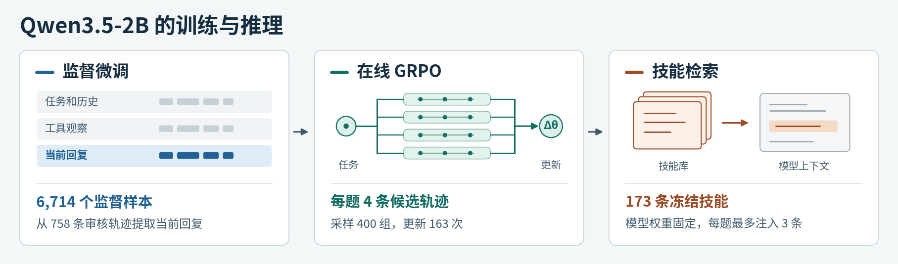
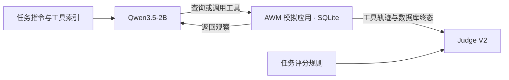
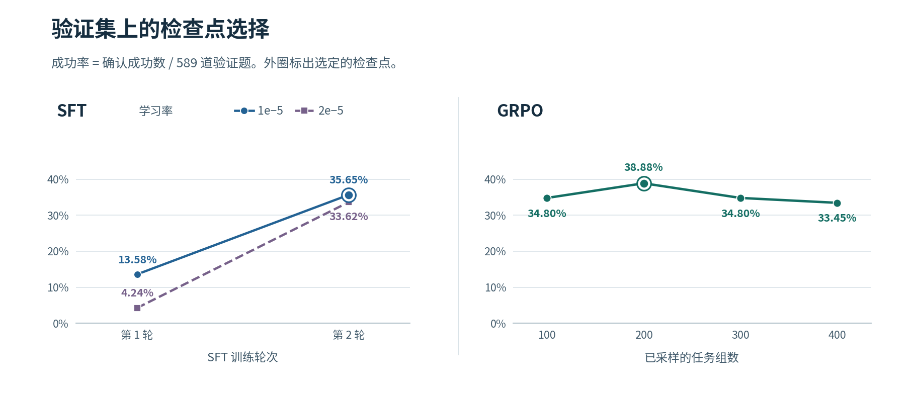

# App Agent

<div align="center">

**简体中文** · [English](README.en.md)

在有独立数据库的模拟应用中，训练 Qwen3.5-2B 发现工具、执行操作并完成多步任务。

[实验结果](#实验结果) · [快速开始](#快速开始) · [代码与文档](#代码与文档)

</div>



## AWM 环境

每道题启动一个独立的 Agent World Model（AWM）应用和 SQLite 数据库。模型先看到任务和工具索引，按需查询工具参数，每轮提交一个 JSON 动作，再根据工具返回的观察决定下一步。模型调用 `finish` 后，Judge V2 对照任务评分规则，结合工具轨迹和数据库终态评估完成情况。[AWM 上游项目](https://github.com/Snowflake-Labs/agent-world-model) · [交互协议](harness_awm/protocol_v2.py)

例如，会员管理校准题要求更新当前账号的电话号码、添加 `corporate` 标签，同时保留已有标签。改对电话号码只满足其中一项要求。Judge 可以从最终账号记录核对标签，从工具轨迹检查模型执行了哪些操作。[校准任务](configs/training/grpo-calibration-controls.json)



## 训练与评测

| 阶段 | 方法 | 代码入口 |
|---|---|---|
| 基模评测 | 用 BF16 和贪心解码运行指定划分，记录逐题完成情况。 | [评测入口](harness_awm/training/evaluate.py) |
| 监督微调（SFT） | 用审核过的轨迹训练。历史消息作为上下文，只对当前助手回复计算损失。 | [SFT 训练](harness_awm/training/sft.py) |
| 在线 GRPO | 同一任务采样四条轨迹，用组内奖励差异更新策略，定期在验证集比较检查点。 | [veRL 训练入口](harness_awm/training/verl/__main__.py) |
| SkillRL 风格的技能检索 | 从训练轨迹提取工作流和失败提醒。推理时按任务检索，模型权重保持冻结。 | [技能提取](harness_awm/skillbank_build.py) · [配对评测](harness_awm/training/skill_eval.py) |

GRPO 的训练奖励为 `R = C × [1 − 0.05 × (1 − S) − 0.15 × (1 − T)]`。完成度 `C` 取决于硬要求。全部通过记 1，任何一项明确失败记 0，其余经复核仍无法判定的情况记 0.3。软要求得分 `S` 和轨迹质量 `T` 决定奖励的折扣幅度。[Judge V2 评分细则](docs/judge_v2_zh.md)

## 实验结果

| 模型与设置 | 验证集（589 题） | 独立测试集（588 题） |
|---|---:|---:|
| 初次 SFT，`checkpoint-210` | **210/589（35.65%）** | 214/588（36.39%） |
| GRPO，第 200 个采样组 | **229/589（38.88%）** | 197/588（33.50%） |
| GRPO-200 + SkillRL 推理增强 | **275/589（46.69%）** | 未评测 |

GRPO-200 的独立测试成绩是 **197/588（33.50%）**。GRPO-200 + SkillRL 的 **275/589（46.69%）** 来自验证集。与初次 SFT 相比，GRPO 在验证集多完成 19 题（**+3.23 个百分点**），在独立测试集少完成 17 题。

成功率按确认成功题数除以该划分的全部题数计算，百分比四舍五入到两位小数。独立测试集固定为 588 题，按这个口径，39.50% 和 47.27% 都没有对应的整数成功题数。[各候选成绩、评分覆盖与来源哈希](docs/qwen35-2b-results.json)

暂定通过和缺失评分的任务也计入分母。三次验证评测的有效评分数分别为 585、581、537，两次独立测试评测分别为 573、567。SFT 使用 OpenAI 判分，GRPO 优先使用 DeepSeek，必要时回退到 OpenAI。

技能实验固定 GRPO-200 权重，单独使用 `deepseek-flash` 判分。589 题中有 275 题确认成功、262 题确认失败、47 题无法判定、5 题未完成推理。该批次缺少同条件关闭技能的对照，技能本身带来的净提升仍待测量。



四个 SFT 候选中，学习率 `1e-5` 的第 2 轮得到 210 次确认成功。GRPO 在第 200 个采样组达到 229 次，此时实际执行了 86 次参数更新。到第 400 组，成功数回落到 197 次。两个阶段都按验证集选定检查点，再评独立测试集。

## 快速开始

从仓库根目录在 Bash 中运行以下步骤。基础工具需要 Python 3.12。训练还需要 `uv`、受支持的 NVIDIA GPU 和驱动、支持 Landlock 的 Linux，以及可用的 Judge API。各阶段使用新的输出目录。

```bash
git clone --recurse-submodules https://github.com/Alden-bai/app-agent.git
cd app-agent
python3.12 -m venv agent-world-model/.venv
agent-world-model/.venv/bin/python -m pip install -e ./agent-world-model -e '.[test]'
cp .env.example .env
agent-world-model/.venv/bin/python -m harness_awm --help
```

下列四步复用环境变量和 `score` 函数，请按顺序在同一个 Bash 会话中运行。复现历史成绩还需要原始冻结数据包，第一步列出了所需输入。

<details>
<summary><strong>1. 准备模型、冻结数据与 Judge 配置</strong></summary>

在本机 `.env` 填自己的 Judge 密钥。SFT 的训练环境使用 CUDA 12.8 依赖，GRPO 在第 3 步另建 veRL/vLLM 环境。下载脚本按仓库中的模型锁校验 Qwen3.5-2B 权重和 tokenizer。

```bash
bash scripts/setup_training.sh cu128-kernels
T="$PWD/.venv-training/bin/python"
WORK="$PWD/runs/reproduce-2b"
MODEL="$PWD/models/Qwen3.5-2B"
SPLIT="$PWD/data/training_split_20261106_v1"
SFT_DATA="$PWD/data/training_qwen35_2b_v1"
TASKS="$PWD/data/training_runtime_20261106_v1"
mkdir -p "$WORK"
"$T" scripts/download_training_model.py --weights --output "$MODEL"
```

**历史数据需要单独准备。** 可以直接使用原有的 `SFT_DATA` 和 `TASKS` 两个冻结数据包。要从源文件重建，需要同一批 SFT 审核记录与逐轮轨迹、A/B 环境筛查结果和索引、已修复的 AWM 数据库、工具定义、原题及评分规则。筛查通过的 3,923 道工具任务按种子 `20261106` 划为 GRPO 训练 2,746 题、验证 589 题、测试 588 题。各划分的任务 ID 互不重复，场景可以重叠。[数据准备与校验](docs/training_setup_zh.md) · [划分脚本](scripts/prepare_training_split.py)

恢复了原始输入且尚无划分时，运行 `"$T" scripts/prepare_training_split.py --root "$PWD" --seed 20261106 --output "$SPLIT"`。搬迁已有冻结划分后，可用 `--replay-frozen --output "$WORK/replayed-split"` 重放并校验来源。取得划分后，仅对尚未生成的数据包执行对应命令。

```bash
"$T" -m harness_awm.training.data --root "$PWD" --split "$SPLIT" \
  --tokenizer "$MODEL" --output "$SFT_DATA"
"$T" -m harness_awm.training.tasks --root "$PWD" --split "$SPLIT" \
  --output "$TASKS"
```

```bash
cp configs/training/skill-inference-eval.json "$WORK/eval.json"
cp configs/training/grpo-landlock-local.json "$WORK/train.json"
```

将两份 JSON 的 `runtime_python` 改为本机 `agent-world-model/.venv/bin/python` 的绝对路径，按所用判分服务配置 `judge_api` 及请求、token 预算。模板中 `null` 表示无累计上限。以下 `score` 函数用 BF16、greedy 和同一套本地评测配置运行所选 checkpoint；加 `--execute` 会调用真实 Judge。需要基模对照时，可对 `"$MODEL"` 使用同一函数。

```bash
score() {
  "$T" -m harness_awm.training.evaluate --config "$WORK/eval.json" \
    --tasks "$TASKS" --split "$1" --model "$2" --output "$3" \
    --dtype bfloat16 --sampling greedy --execute
}
```

</details>

<details>
<summary><strong>2. 训练 SFT 并选择检查点</strong></summary>

758 条保留轨迹有 7,071 轮，其中 357 轮屏蔽当前回复的损失，得到 6,714 个训练样本。只监督当前 assistant 回复，历史动作仍作为上下文。两个学习率分别从原始基模训练 2 轮，有效 batch 为 64，每轮保存一次。

```bash
for lr in 1e-5 2e-5
do
  PYTORCH_ALLOC_CONF=expandable_segments:True "$T" -m harness_awm.training.sft \
    --model "$MODEL" --data "$SFT_DATA" --output "$WORK/sft-$lr" \
    --epochs 2 --learning-rate "$lr" --batch-size 64 --gradient-accumulation 1 \
    --microbatch-tokens 122880 --save-strategy epoch --save-total-limit 2 --skip-final-save
  for step in 105 210
  do
    score validation "$WORK/sft-$lr/checkpoint-$step" "$WORK/val-sft-$lr-$step"
  done
done
```

先比较四份验证报告的确认成功数，同分时依次比较有效评分数与奖励总和。历史胜者是 `1e-5` 的第 2 轮。下方变量取历史胜者，重跑时请按本次验证结果设定，随后评 588 题独立测试集。[SFT 选模记录](docs/sft_selection_zh.md)

```bash
BEST_SFT="$WORK/sft-1e-5/checkpoint-210"
score test "$BEST_SFT" "$WORK/test-sft"
```

</details>

<details>
<summary><strong>3. 运行在线 GRPO 并评测验证集胜者</strong></summary>

历史单卡运行使用 veRL、vLLM 和 CUDA 13 的 `local-sdpa` 配置。先用两道训练控制题实测 Judge，再为训练池的每个任务绑定原题、评分规则、环境和工具哈希。校准会调用配置好的 Judge。[veRL 环境与奖励校准](docs/verl_training_zh.md)

```bash
python3.12 scripts/setup_verl_grpo_local.py --venv "$PWD/.venv-grpo" \
  --source "$PWD/vendor/verl" --work "$WORK/verl-build"
G="$PWD/.venv-grpo/bin/python"
"$T" scripts/calibrate_verl_grpo.py --config "$WORK/train.json" --tasks "$TASKS" \
  --task e_commerce_marketplace_10:0 --task membership_management_2:0 \
  --output "$WORK/calibration"
"$T" scripts/prepare_full_grpo_admissions.py --config "$WORK/train.json" \
  --tasks "$TASKS" --calibrated "$WORK/calibration/reward_admissions.json" \
  --output "$WORK/admissions"
```

从最佳 SFT 开始，按固定种子打乱训练池，每题在线采样 4 条轨迹。按任务完成度、软要求和过程质量计算奖励，组内同分时跳过参数更新。历史运行采样 400 组，共 1,600 条轨迹，实际更新 163 次。下面按采样组计数，每 100 组保存一次。显存参数对应历史高显存单卡配置。

```bash
"$G" -m harness_awm.training.verl prepare --preset single-gpu-800 \
  --config "$WORK/admissions/config.json" --tasks "$TASKS" --model "$BEST_SFT" \
  --output "$WORK/grpo" --checkpoint-dir "$WORK/checkpoints" --shuffle-tasks \
  --steps 400 --group-size 4 --save-every 100 --gpu-memory-utilization 0.80 \
  --allocator-gb 94 --gpu-stop-gb 98 --pilot-guards
"$G" -m harness_awm.training.verl check --run "$WORK/grpo"
"$G" -m harness_awm.training.verl train --run "$WORK/grpo"
for group in 100 200 300 400
do
  score validation "$WORK/checkpoints/group_step_$group/actor/huggingface" "$WORK/val-grpo-$group"
done
```

第 100、200、300、400 组的验证成功数分别为 205、229、205、197。胜出的第 200 组对应 86 次优化器更新。冻结验证胜者后再评测试集。

```bash
BEST_GRPO="$WORK/checkpoints/group_step_200/actor/huggingface"
score test "$BEST_GRPO" "$WORK/test-grpo"
```

</details>

<details>
<summary><strong>4. 构建技能库并评测 SkillRL 推理</strong></summary>

从 `grpo_train` 的 241 个封存组、964 条候选轨迹中按规则提炼出 171 条工具工作流和 2 条失败提醒，覆盖 103 个场景。推理时按任务文字检索，工作流还需匹配场景、工具和 schema。每题最多加入 3 条技能、5,000 个 UTF-8 字节。589 道验证题中，147 题有检索命中。整个阶段固定模型权重。[冻结技能库](delivery/skillrl/bank.json) · [技能索引](delivery/skillrl/SKILLS.md)

历史批次先用 `harness_awm.training.skill_infer` 封存带技能轨迹，再对 584 条已完成轨迹和对应评分规则运行 DeepSeek 判分。要从原始归档重建技能库，将 `ARCHIVES` 设为包含那 241 组归档的目录，再执行下面的命令。[推理流程](docs/skill_inference_zh.md) · [历史判分实现](scripts/judge_today_skills.py)

```bash
"$T" -m harness_awm.skillbank_build --tasks "$TASKS" \
  --archives "$ARCHIVES" --output "$WORK/rebuilt-bank"
```

也可以直接用仓库中的冻结技能库。`prepare_delivery_skills.py` 会校验原始任务包的 manifest 哈希；使用新生成的任务包时，应从对应训练轨迹重建库并使用其 `inference_skills.json`。下面是新的配对实验，同一模型、题目、解码和 Judge 各跑一遍关闭与开启技能，结果写入 `comparison.json`。去掉 `--execute` 并改用新的输出目录可先做离线预检。

```bash
"$T" scripts/prepare_delivery_skills.py --tasks "$TASKS" \
  --bundle delivery/skillrl --output "$WORK/skills.json"
"$T" -m harness_awm.training.skill_eval --config "$WORK/eval.json" \
  --tasks "$TASKS" --model "$BEST_GRPO" --skills "$WORK/skills.json" \
  --split validation --limit 0 --output "$WORK/skill-paired" --execute
```

</details>

## 代码与文档

| 想了解什么 | 从哪里开始 |
|---|---|
| 怎样运行工具、回放任务和检查证据 | [AWM 执行与评测](docs/harness_readme_zh.md) · [Judge V2 判分](docs/judge_v2_zh.md) |
| 怎样准备数据、训练和选择检查点 | [基模评测](docs/baseline_evaluation_zh.md) · [训练环境与 SwanLab](docs/training_setup_zh.md) · [SFT 选模](docs/sft_selection_zh.md) · [GRPO 训练](docs/verl_training_zh.md) |
| 检索哪些技能、如何复现实验 | [冻结技能索引](delivery/skillrl/SKILLS.md) · [技能推理与配对评测](docs/skill_inference_zh.md) |
| 怎样核对图表中的数字 | [Qwen3.5-2B 实验汇总、评分覆盖与来源哈希](docs/qwen35-2b-results.json) |

Qwen3.5-27B 的单机 8×A100 方案使用独立配置，计划训练 2,000 道 GRPO 任务。本页图表来自 Qwen3.5-2B 实验。[27B 交接说明](delivery/README_交接说明.md) · [8×A100 运行方案](delivery/nioflow/README.md)
